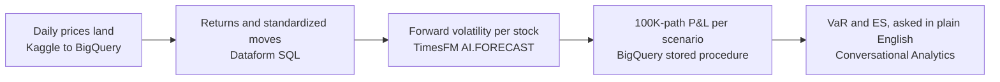

# Market Risk VaR on BigQuery

Run a bank-style 1-day Value at Risk workflow end to end in BigQuery: land market data, forecast forward volatility with TimesFM, run a 100,000-path Monte Carlo, re-run it under a stress shock, and ask the results questions in plain English. There is no cluster to provision and no data leaves BigQuery. Clone the repo, point it at your own GCP project, and run `tofu apply`.

The portfolio belongs to **Pulsar Capital**, a fictional trading firm whose three equity desks hold about $100M of US large-cap stocks. Prices are real.

- **Real market data:** daily prices for the S&P 500 members from 2000 on, loaded from a public [Kaggle dataset](https://www.kaggle.com/datasets/darkmatternet/s-and-p-500-stocks-25-years-of-data-updated-daily) (CC0) and pinned to an as-of date
- **TimesFM in SQL:** one `AI.FORECAST` query forecasts every stock in the portfolio, and its prediction intervals set each stock's forward volatility
- **Monte Carlo in SQL:** 100,000 paths of filtered historical simulation, with fat tails and real cross-stock correlation, giving VaR and Expected Shortfall per desk and per stress scenario
- **Plain-English answers:** a Conversational Analytics data agent over the results, with verified queries that pin the risk definitions
- **Notebooks in BigQuery Studio:** the whole walkthrough as a Python notebook with charts, deployed by `tofu apply`

See [`docs/`](docs/README.md) for the step-by-step guide and [`docs/quick.md`](docs/quick.md) for copy-paste queries.

## Architecture

What happens, from prices to answers:



How the pieces are connected, step by step: [`docs/architecture.md`](docs/architecture.md).

The data agent answering a stress question in plain English, after you add a Tech scenario:


*Console on 2026-10-25.*

## Prerequisites

| Requirement | Notes |
| --- | --- |
| A GCP project with billing | Create it once, before the first apply. The commands are below. |
| [Google Cloud CLI](https://cloud.google.com/sdk/docs/install) | Provides `gcloud` and `bq`. Tofu calls both during the apply. |
| [OpenTofu](https://opentofu.org) 1.6 or later | `setup.sh` runs `tofu init`. |
| `curl` and `python3` | The apply downloads the market data with `curl` and deploys the notebooks with a small Python script. |

The project ID must be globally unique. Create the project, then log in twice. Tofu uses the application default credentials. `bq` and `gcloud` use the CLI login.

```bash
PROJECT_ID=<your-project-id>
gcloud projects create "$PROJECT_ID" --organization=<YOUR_ORG_ID>
gcloud billing projects link "$PROJECT_ID" --billing-account=<YOUR_BILLING_ACCOUNT>
gcloud auth login
gcloud auth application-default login
```

Set `project_id`'s default to your project ID. That one value drives the providers, the resources, the bucket names and `setup.sh`. In `infra/variables.tf`, line 13, in the `project_id` variable:

```diff
-  default     = "datacloud-market-risk"
+  default     = "<your-project-id>"
```

Or make the same edit from the terminal:

```bash
perl -pi -e "s/default     = \"datacloud-market-risk\"/default     = \"$PROJECT_ID\"/" infra/variables.tf
```

The Dataform repository pulls the SQL from this public GitHub repo over an anonymous link, so you need no GitHub token. To change the SQL, fork the repo and set `git_repo_url` in `infra/variables.tf` to your fork.

## Quickstart

```bash
./infra/scripts/setup.sh   # one time per project: APIs, state bucket, tofu init
cd infra && tofu apply     # zero required variables
```

The apply enables the APIs, creates the datasets and tables, downloads the market data from Kaggle, runs the Dataform pipeline once, and creates the data agent and the notebooks. The first pipeline run retries while IAM propagates.

## Verify

```sql
SELECT scenario_id, method, var_99_usd, es_99_usd, var_99_pct_notional
FROM `serving.portfolio_var_summary`
ORDER BY method, scenario_id;

SELECT * FROM `assertions.market_data_integrity`;      -- must be empty
SELECT * FROM `assertions.timesfm_forecast_complete`;  -- must be empty
SELECT * FROM `assertions.var_sanity`;                 -- must be empty
```

A healthy run gives a baseline Monte Carlo 99% VaR of about 1% to 3% of notional, with Expected Shortfall above it. A failing assertion fails the pipeline run.

## Try it

Follow [Value at Risk](docs/01-value-at-risk.md). You read the TimesFM forecast, trace one Monte Carlo path, add your own stress scenario and simulate it, then ask the data agent about the results.

To follow it as a notebook with charts instead, open **BigQuery Studio > Notebooks > 01 Value At Risk**. When it asks for a runtime, select **Runtime > Connect to a runtime > Create new runtime** and choose the **Market risk notebooks** template.

## What gets created

| Resource | Notes |
| --- | --- |
| BigQuery datasets `raw`, `processed`, `serving`, `assertions` | One per pipeline stage, plus data-quality checks |
| Tables `raw.sp500_daily_prices`, `raw.sp500_companies` | The Kaggle files, loaded by `infra/scripts/load_market_data.sh` |
| Table `raw.stress_scenarios` | Seeded with `baseline` and `energy_down_15`. You add rows to it. |
| Procedure `serving.simulate_scenario` | Runs the Monte Carlo for one scenario |
| Dataform repository | Linked anonymously to this repo, pulls from `main` |
| Data agent `pulsar_market_risk` | Under **BigQuery > Agents** |
| Notebooks `01 Value At Risk`, `Run Pipeline` | Under **BigQuery Studio > Notebooks**, from `notebooks/*.ipynb` |
| Runtime template `Market risk notebooks` | Colab Enterprise runtime for the notebooks, on the `notebooks` network with no public IP |
| Network `notebooks`, subnet `notebooks-<region>` | Private Google Access, so the runtime reaches Google APIs without a public IP |
| Bucket `<project>-landing` | The downloaded Kaggle files |
| Service account `dataform-runner` | Pipeline runs execute as it |

## Known limitations

- The Kaggle dataset covers the **current** S&P 500 members only, as its publisher states, so its history has survivorship bias. If a stock the portfolio holds is missing from a download, `assertions.market_data_integrity` fails the run.
- The portfolio is long-only equities. Options and other non-linear positions are out of scope.

## Cleanup

```bash
cd infra && tofu destroy
```

These stay after `tofu destroy`:

| Left behind | Why | Remove with |
| --- | --- | --- |
| The project | Tofu did not create it | `gcloud projects delete "$PROJECT_ID"` |
| `gs://<project>-tfstate` | It holds the state that `destroy` uses | `gcloud storage rm -r "gs://$PROJECT_ID-tfstate"` |
| Enabled APIs | Tofu leaves them on so that a shared project does not break | `gcloud services disable`, if you want |

Deleting the project removes all of them.
