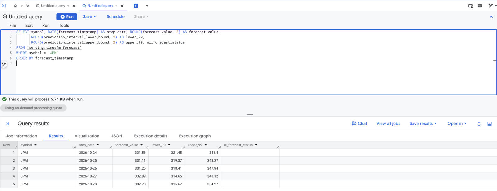
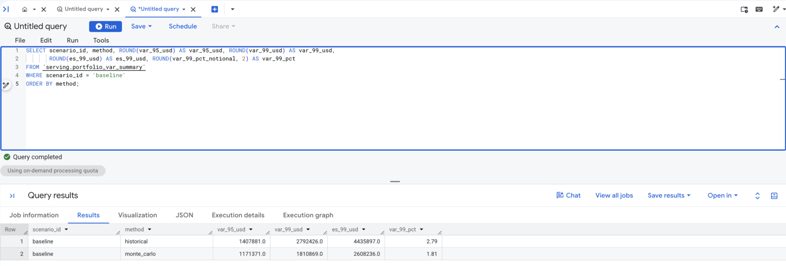
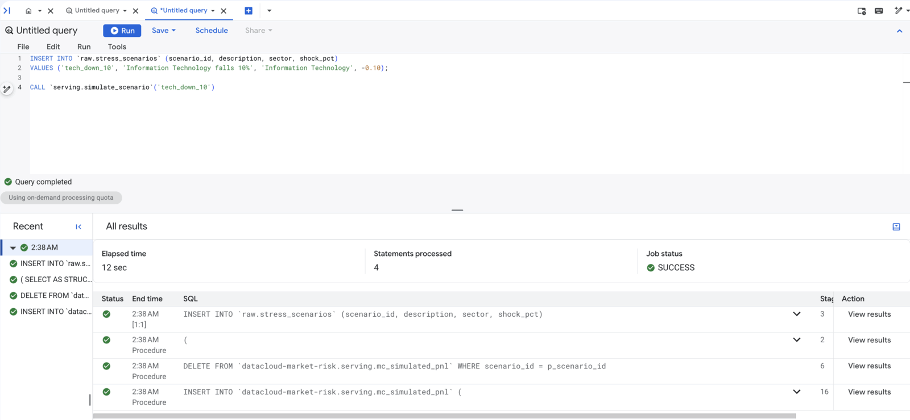
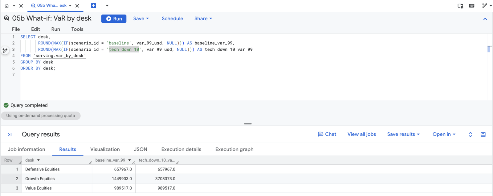
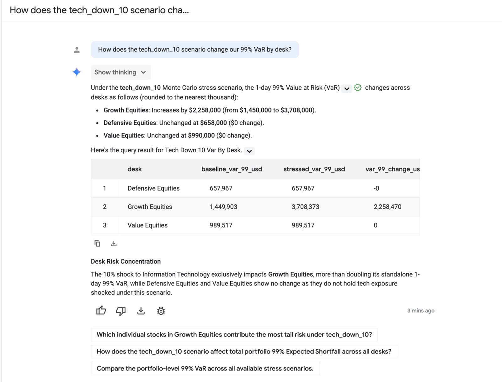
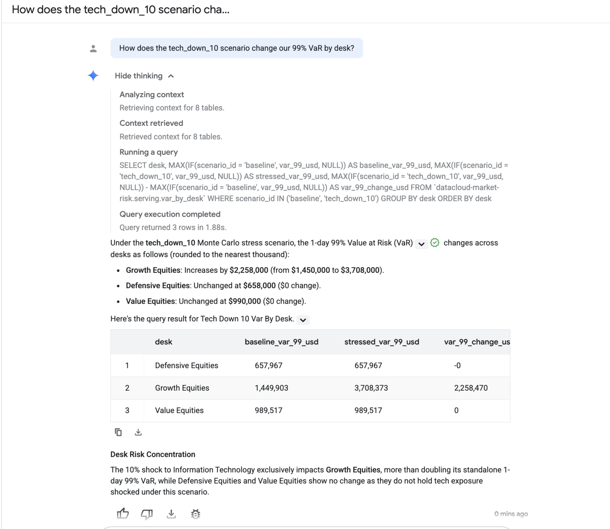

# Value at Risk

You follow one risk number from market data to a plain-English answer: read the TimesFM forecast, trace a Monte Carlo path, compare forward-looking and historical VaR, add your own stress scenario, and ask the data agent about it.

Run every query in **BigQuery Studio** in your project. To follow the same steps as a notebook with charts, open **BigQuery Studio > Notebooks > 01 Value At Risk** and connect it to a runtime from the **Market risk notebooks** template. The sample output comes from a run with an as-of date of 2026-10-23. Your numbers differ slightly, because TimesFM does not always return identical intervals for identical input.

---

## Step 1: Look at the portfolio

Pulsar Capital holds 30 US large-cap stocks across three desks:

```sql
SELECT desk, book, COUNT(*) AS positions, SUM(notional_usd) AS notional_usd
FROM `raw.portfolio_positions`
GROUP BY desk, book
ORDER BY desk, book;
```

```text
+--------------------+---------------+-----------+--------------+
|        desk        |     book      | positions | notional_usd |
+--------------------+---------------+-----------+--------------+
| Defensive Equities | US Healthcare |         6 |     21000000 |
| Growth Equities    | US Consumer   |         5 |     15000000 |
| Growth Equities    | US Tech       |         7 |     30000000 |
| Value Equities     | US Energy     |         5 |     13000000 |
| Value Equities     | US Financials |         7 |     21000000 |
+--------------------+---------------+-----------+--------------+
```

The prices behind these positions are in `raw.sp500_daily_prices`, one row per stock per trading day since 2000. `processed.daily_returns` turns them into daily log returns, up to the as-of date set in `workflow_settings.yaml`.

---

## Step 2: Read the TimesFM forecast

One `AI.FORECAST` query forecasts all 30 stocks, using four years of daily closes each. This is its raw output for JPMorgan:

```sql
SELECT symbol, DATE(forecast_timestamp) AS step_date, ROUND(forecast_value, 2) AS forecast_value,
       ROUND(prediction_interval_lower_bound, 2) AS lower_99,
       ROUND(prediction_interval_upper_bound, 2) AS upper_99, ai_forecast_status
FROM `serving.timesfm_forecast`
WHERE symbol = 'JPM'
ORDER BY forecast_timestamp;
```

```text
+--------+------------+----------------+----------+----------+--------------------+
| symbol | step_date  | forecast_value | lower_99 | upper_99 | ai_forecast_status |
+--------+------------+----------------+----------+----------+--------------------+
| JPM    | 2026-10-24 |         331.56 |   321.45 |    341.5 |                    |
| JPM    | 2026-10-25 |         331.11 |   319.37 |   343.27 |                    |
| JPM    | 2026-10-26 |         331.25 |   318.41 |   347.94 |                    |
| JPM    | 2026-10-27 |         332.89 |   314.65 |   348.12 |                    |
| JPM    | 2026-10-28 |         332.78 |   315.67 |   354.27 |                    |
+--------+------------+----------------+----------+----------+--------------------+
```



*Console on 2026-10-25.*

The interval widens with each step, as uncertainty should. The first step is dated Saturday 2026-10-24: TimesFM infers a daily step from the input and does not know about weekends, so read step 1 as the next trading day.

The simulation needs a volatility, not a price. `serving.timesfm_forward_params` converts the 99% interval for step 1 into one, assuming log-normal prices: `ln(upper / lower) / (2 × 2.5758)`.

```sql
SELECT symbol, ROUND(last_close, 2) AS last_close,
       ROUND(forecast_low_99, 2) AS low_99, ROUND(forecast_high_99, 2) AS high_99,
       ROUND(100 * timesfm_vol_annualized, 1) AS timesfm_vol_pct,
       ROUND(100 * historical_vol_annualized, 1) AS historical_vol_pct
FROM `serving.timesfm_forward_params`
WHERE symbol IN ('JPM', 'NVDA', 'XOM', 'GOOGL')
ORDER BY symbol;
```

```text
+--------+------------+--------+---------+-----------------+--------------------+
| symbol | last_close | low_99 | high_99 | timesfm_vol_pct | historical_vol_pct |
+--------+------------+--------+---------+-----------------+--------------------+
| GOOGL  |     320.21 |  305.3 |   333.7 |            27.4 |               31.5 |
| JPM    |     331.58 | 321.45 |   341.5 |            18.6 |               22.2 |
| NVDA   |     210.96 |  202.1 |  221.08 |            27.7 |               37.6 |
| XOM    |     183.21 | 177.38 |  190.05 |            21.2 |               26.2 |
+--------+------------+--------+---------+-----------------+--------------------+
```

TimesFM's forward volatility is below the trailing year for every stock here, and for 21 of the 30 in the portfolio: its next-day band is narrower than the last year of daily moves would suggest. The demo uses the band as a volatility input. It does not claim the forward view is more accurate.

The median forecast is not used as a drift. Over one day its implied move is noise, so the simulation assumes zero drift.

---

## Step 3: Trace one Monte Carlo path

`serving.mc_simulated_pnl` holds 100,000 paths × 30 positions per scenario. Each path replays one of the last 1,000 trading days for all 30 stocks together, so the stocks move the way they actually moved together that day. Each stock's move is first divided by its volatility at the time, then multiplied by its TimesFM volatility today. A small amount of extra noise per stock makes every path distinct. The 100,000 paths are a smoothed bootstrap of those 1,000 real days, about 100 paths per day: the path count makes the distribution smooth, not better informed.

Path 42 replays 2025-08-12:

```sql
SELECT scenario_id, path_id, historical_date, symbol, desk, notional_usd,
       ROUND(sim_log_return, 5) AS sim_log_return, ROUND(sim_pnl_usd, 2) AS sim_pnl_usd
FROM `serving.mc_simulated_pnl`
WHERE scenario_id = 'baseline' AND path_id = 42 AND symbol IN ('AAPL', 'JPM', 'XOM')
ORDER BY symbol;
```

```text
+-------------+---------+-----------------+--------+-----------------+--------------+----------------+-------------+
| scenario_id | path_id | historical_date | symbol |      desk       | notional_usd | sim_log_return | sim_pnl_usd |
+-------------+---------+-----------------+--------+-----------------+--------------+----------------+-------------+
| baseline    |      42 |      2025-08-12 | AAPL   | Growth Equities |    7000000.0 |        0.00574 |    40285.39 |
| baseline    |      42 |      2025-08-12 | JPM    | Value Equities  |    6000000.0 |        0.01282 |    77444.54 |
| baseline    |      42 |      2025-08-12 | XOM    | Value Equities  |    5000000.0 |        0.01039 |    52241.61 |
+-------------+---------+-----------------+--------+-----------------+--------------+----------------+-------------+
```

Sum the 30 rows and you get the portfolio's P&L on that path, here about +$1.34M. VaR is a percentile of that sum across all 100,000 paths.

---

## Step 4: Compare forward-looking and historical VaR

```sql
SELECT scenario_id, method, ROUND(var_95_usd) AS var_95_usd, ROUND(var_99_usd) AS var_99_usd,
       ROUND(es_99_usd) AS es_99_usd, ROUND(var_99_pct_notional, 2) AS var_99_pct
FROM `serving.portfolio_var_summary`
WHERE scenario_id = 'baseline'
ORDER BY method;
```

```text
+-------------+-------------+------------+------------+-----------+------------+
| scenario_id |   method    | var_95_usd | var_99_usd | es_99_usd | var_99_pct |
+-------------+-------------+------------+------------+-----------+------------+
| baseline    | historical  |  1465224.0 |  2732315.0 | 4424646.0 |       2.73 |
| baseline    | monte_carlo |  1371047.0 |  2306919.0 | 2934727.0 |       2.31 |
+-------------+-------------+------------+------------+-----------+------------+
```



*Console on 2026-10-25.*

On 99 days out of 100, the Monte Carlo expects Pulsar Capital to lose less than about $2.3M in a day. On the worst 1% of days it expects to lose about $2.9M on average: that is the Expected Shortfall.

Historical VaR is higher. To see why, list the days that drive it:

```sql
SELECT date, ROUND(pnl_usd) AS pnl_usd, worst_day_rank
FROM `serving.historical_pnl`
ORDER BY worst_day_rank
LIMIT 5;
```

```text
+------------+------------+----------------+
|    date    |  pnl_usd   | worst_day_rank |
+------------+------------+----------------+
| 2025-04-03 | -5912010.0 |              1 |
| 2025-04-04 | -5778544.0 |              2 |
| 2025-04-10 | -4455143.0 |              3 |
| 2025-03-10 | -3188433.0 |              4 |
| 2024-12-18 | -2789102.0 |              5 |
+------------+------------+----------------+
```

Two things separate the numbers. The historical view uses the last 500 trading days and the simulation draws from the last 1,000, so the April 2025 tariff selloff weighs more in the historical tail. That window difference is most of the gap. The simulation also rescales each day to TimesFM's volatility, which accounts for a smaller part.

---

## Step 5: Add a stress scenario and simulate it

Ask a what-if: Information Technology falls 10% tomorrow. Add the scenario, then simulate it:

```sql
INSERT INTO `raw.stress_scenarios` (scenario_id, description, sector, shock_pct)
VALUES ('tech_down_10', 'Information Technology falls 10%', 'Information Technology', -0.10);

CALL `serving.simulate_scenario`('tech_down_10');
```

The procedure writes 3,000,000 rows to `serving.mc_simulated_pnl`. The whole script, insert included, took 10 to 20 seconds in test runs. The **Job information** tab shows each statement the procedure ran:



*Console on 2026-10-25.*

The views read that table, so they include the new scenario straight away:

```sql
SELECT desk,
       ROUND(MAX(IF(scenario_id = 'baseline', var_99_usd, NULL))) AS baseline_var_99,
       ROUND(MAX(IF(scenario_id = 'tech_down_10', var_99_usd, NULL))) AS tech_down_10_var_99
FROM `serving.var_by_desk`
GROUP BY desk
ORDER BY desk;
```

```text
+--------------------+-----------------+---------------------+
|        desk        | baseline_var_99 | tech_down_10_var_99 |
+--------------------+-----------------+---------------------+
| Defensive Equities |        657967.0 |            657967.0 |
| Growth Equities    |       1449903.0 |           3708373.0 |
| Value Equities     |        989517.0 |            989517.0 |
+--------------------+-----------------+---------------------+
```



*Console on 2026-10-25.*

Only Growth Equities moves, because it holds all the Information Technology stocks. GOOGL sits in the US Tech book but is Communication Services under GICS, so this shock does not hit it. The other desks are unchanged to the dollar: every scenario replays the same draws on the same paths, so the shock is the only difference.

A shock is applied on top of every path, so the result is VaR given the shock: the baseline risk plus the shock's loss. It is not Basel stressed VaR, which recalibrates the model to a stressed historical period.

---

## Step 6: Ask the data agent

In the Google Cloud console, open **BigQuery > Agents**, select **Pulsar Capital market risk**, and start a chat. Try:

- *What is our total portfolio 99% Value at Risk and Expected Shortfall across all desks?*
- *Which 5 stocks contribute the most tail risk?*
- *How does the tech_down_10 scenario change our 99% VaR by desk?*
- *Which days drive our historical VaR?*
- *Show the distribution of simulated portfolio P&L across the Monte Carlo paths for the baseline.*

The third question names your new scenario; the agent finds it in the data without any change to its setup:



*Console on 2026-10-25.*

Select **Show thinking** to see the SQL the agent ran. For questions that match a verified query, such as the first one, the SQL follows it:



*Console on 2026-10-25.*

---

## Key Takeaways

| Capability | Technology | Business value |
| --- | --- | --- |
| Forward volatility for every stock in one query | TimesFM through `AI.FORECAST` | A forward-looking risk input with no model to train or serve |
| 100,000-path Monte Carlo with fat tails and real correlation | BigQuery SQL and a stored procedure | Desk-level VaR and Expected Shortfall without a compute cluster or data movement |
| What-if in one insert and one call | `raw.stress_scenarios` and `serving.simulate_scenario` | Stress results in seconds, while the question is still being asked |
| Risk answers in plain English | Conversational Analytics data agent | Desk heads read tail risk without writing SQL or waiting for the risk team |

---

## What's Next

Predict the result before you run each one.

1. **A market-wide shock.** A scenario with no sector shocks every stock:
   ```sql
   INSERT INTO `raw.stress_scenarios` (scenario_id, description, sector, shock_pct)
   VALUES ('market_down_5', 'Every stock falls 5%', NULL, -0.05);
   CALL `serving.simulate_scenario`('market_down_5');
   ```
   Does portfolio VaR rise by about 5% of notional, or by more?
2. **A rally.** A positive shock on Energy (`shock_pct = 0.10`, scenario `energy_up_10`). How far does Value Equities' VaR fall? Can a VaR go below zero?
3. **Which stocks drive a stress tail.** Query `serving.var_contributions` for one of your scenarios and compare the top contributors with the baseline.

To undo any of them, delete the scenario from both tables:

```sql
DELETE FROM `serving.mc_simulated_pnl` WHERE scenario_id = 'market_down_5';
DELETE FROM `raw.stress_scenarios` WHERE scenario_id = 'market_down_5';
```

The next pipeline run rebuilds `serving.mc_simulated_pnl` from every scenario still in `raw.stress_scenarios`.

---

## Navigation

[← Overview](README.md) | [Quick Reference](quick.md) | [Architecture](architecture.md)
