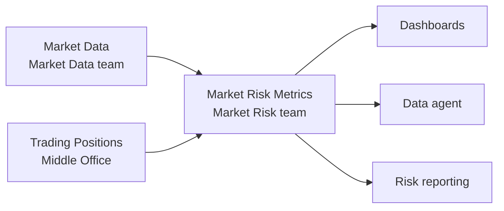
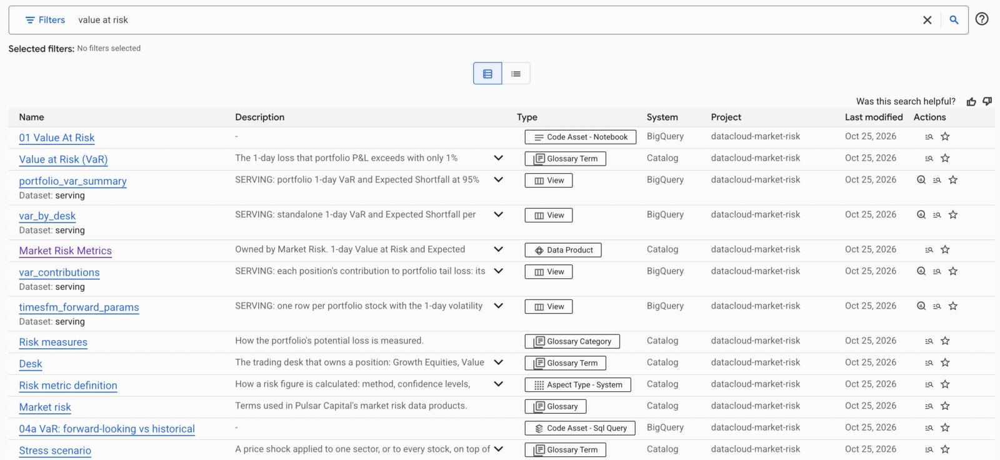
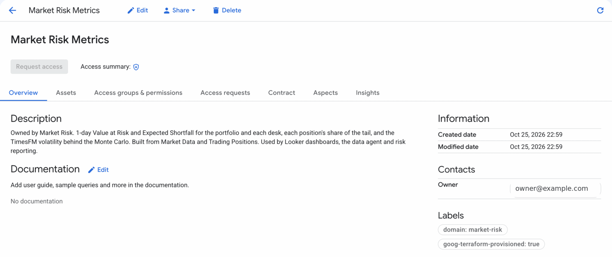
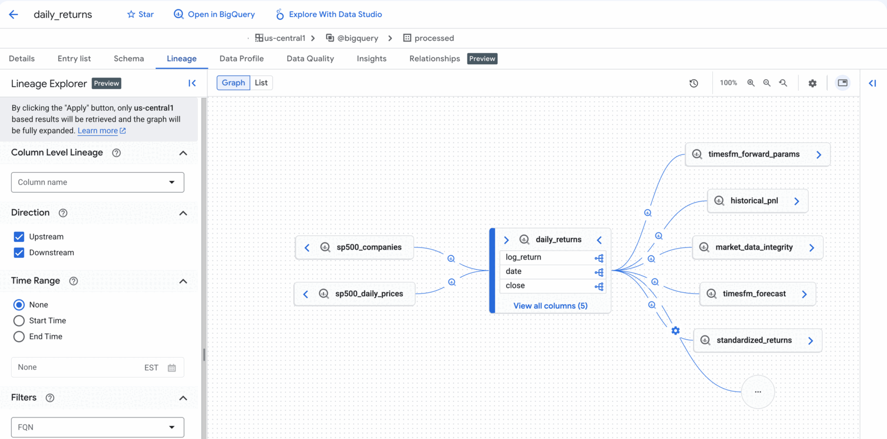
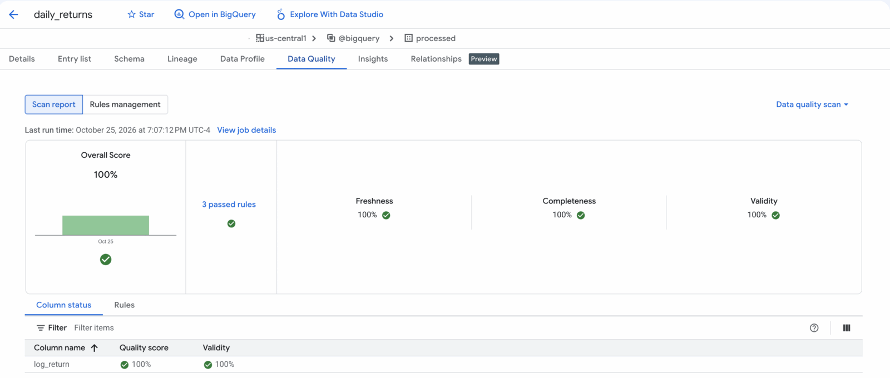
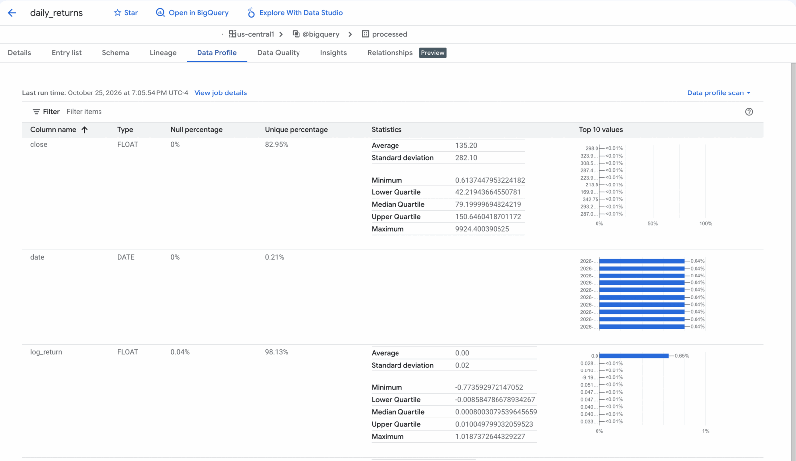
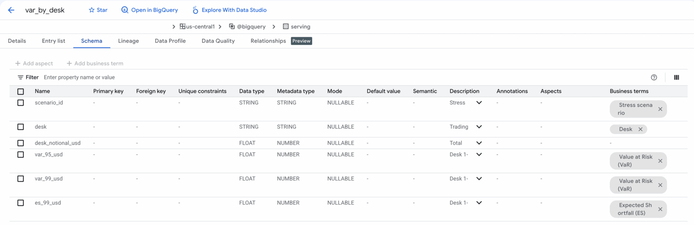
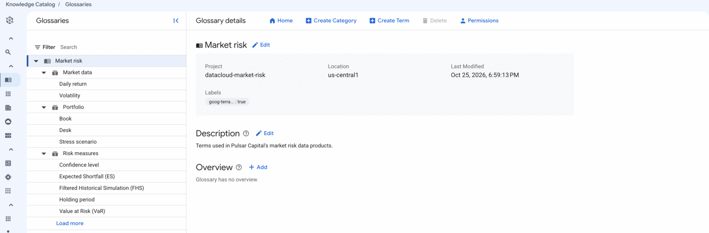
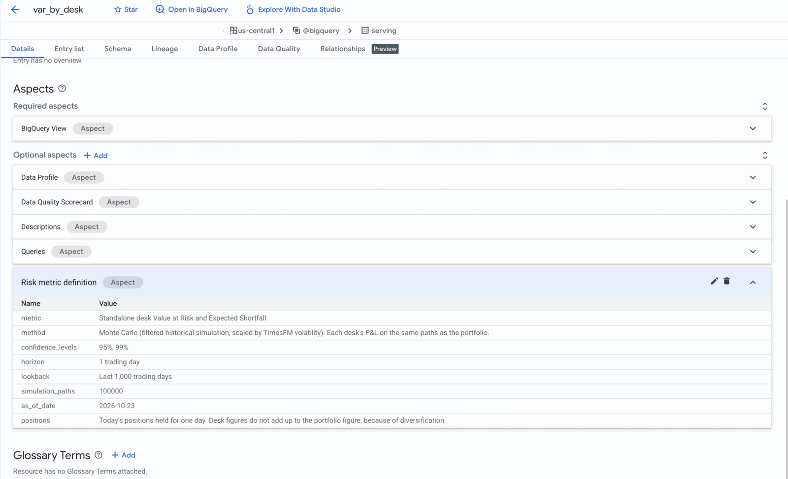
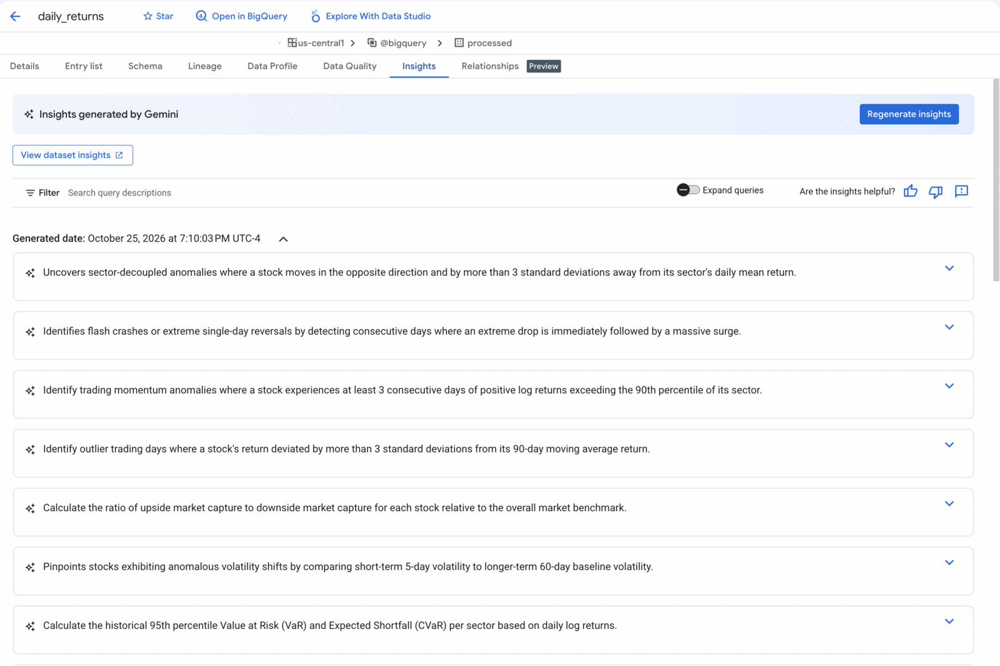

# Governed Risk Data

You check whether the risk numbers can be trusted, using Knowledge Catalog: find the data product that publishes them, trace a VaR figure back to raw prices, read the quality results on its inputs, and look up what each column means.

The [Value at Risk](01-value-at-risk.md) guide answers "what is our risk?". This guide answers the questions that come next: where did this number come from, can I trust today's inputs, and who owns them?

> [!NOTE]
> The quality checks and lineage in this repo are inspired by common risk data aggregation principles, such as those in [BCBS 239](https://www.bis.org/publ/bcbs239.htm): accuracy, completeness, timeliness and traceability. This repo is a learning example. It does not implement, assess or certify compliance with BCBS 239 or any other regulation.

---

## The data products

`tofu apply` publishes the pipeline's tables as three data products. Each one has an owner, a description and a set of assets. Market Risk Metrics is built from the other two.



| Data product | Owner (fictional team) | Assets |
| --- | --- | --- |
| **Market Data** | Market Data | `raw.sp500_daily_prices`, `raw.sp500_companies`, `processed.daily_returns` |
| **Trading Positions** | Middle Office | `raw.portfolio_positions` |
| **Market Risk Metrics** | Market Risk | `serving.portfolio_var_summary`, `serving.var_by_desk`, `serving.var_contributions`, `serving.timesfm_forward_params` |

Everything is in one project. The teams are fictional, and the owner email on each product is the account that ran `tofu apply`. In a real data mesh each team would usually own its own project.

Two objects stay outside the products:

- `serving.simulate_scenario` is a stored procedure, so the catalog cannot scan it.
- `assertions.risk_model_health` is a warning view that is expected to return rows. A pass or fail quality score on it would mislead.

---

## Before you start

Check that every scan ran and passed:

```bash
python3 scripts/verify_catalog.py
```

```text
Scans
  ok   daily-returns-insights: SUCCEEDED
  ok   daily-returns-profile: SUCCEEDED
  ok   daily-returns-quality: SUCCEEDED, 3/3 rules passed
  ...
Data products
  ok   market-data: 3/3 assets
  ok   trading-positions: 1/1 assets
  ok   market-risk-metrics: 4/4 assets

Glossary
  ok   market-risk: 10/10 terms

Lineage
  ok   serving.var_by_desk traces back to raw.sp500_daily_prices
  ok   serving.var_by_desk traces back to raw.portfolio_positions

All checks passed.
```

The insights scans start 3 minutes after the others. If the apply just finished, run `python3 scripts/verify_catalog.py --wait=10` to wait for them.

---

## Step 1: Find the risk data

In the console, open **Knowledge Catalog > Search** and search for `value at risk`. The results mix every kind of catalog entry: the glossary term, the risk views, the **Market Risk Metrics** data product, the glossary and its categories, the custom aspect type, and the notebook and saved queries.



*Console on 2026-10-26.*

To list only the data products, open **Filters** and set **Type** to **Data Product**. All three are listed.

Open **Market Risk Metrics**. The **Overview** tab shows:

- **Description:** what it holds, who builds it and who uses it
- **Owner**, under **Contacts:** who to ask about the data
- **Labels**, including `domain: market-risk`

The **Assets** tab lists the four views. **Access groups & permissions** and **Access requests** are where consumer access is managed. This deployment sets no access group unless you add one (see [Give a consumer team access](#optional-give-a-consumer-team-access)).



*Owner email replaced. Console on 2026-10-26.*

A consumer, such as a dashboard team, starts here instead of browsing datasets.

---

## Step 2: Trace a number to its source

Open `var_by_desk` from the search results, then the **Lineage** tab. The same tab is in BigQuery Studio.

The graph opens one step in each direction: `mc_simulated_pnl` upstream, `risk_model_health` downstream. Click the arrow on a node to expand it, or click **Apply** in the **Lineage Explorer** panel to expand the whole graph. The desk VaR view reads from `mc_simulated_pnl`, which reads from `portfolio_positions`, `standardized_returns` and `timesfm_forward_params`. Following those back reaches `raw.sp500_daily_prices` and the Cloud Storage bucket the Kaggle files landed in.

The middle of that chain, `processed.daily_returns`, shows both directions at once. It is built from the two raw tables and feeds the TimesFM forecast, the standardized returns, the historical P&L and an assertion:



*Console on 2026-10-26.*

Nothing in the repo declares this lineage. BigQuery records it from the queries Dataform and the loader ran.

The **Relationships** tab (Preview) on the same entry lists the join keys BigQuery saw in query history, such as `daily_returns.symbol = portfolio_positions.symbol`. These are not declared in the repo either.

---

## Step 3: Check the inputs

Open `processed.daily_returns`, then its **Data quality** tab. Every rule passed on the last run, and the score is broken down by dimension:



*Console on 2026-10-26.*

Every data product asset has its own rules:

| Asset | Rule | Dimension |
| --- | --- | --- |
| `sp500_daily_prices` | Every close is above 0. Volume is never negative. | Validity |
| | Symbol and date are never empty. | Completeness |
| | Prices reach the pinned as-of date. | Freshness |
| `sp500_companies` | One row per symbol. | Uniqueness |
| | Every sector is one of the 11 GICS sectors. | Validity |
| `daily_returns` | 99.99% of daily log returns are between -0.5 and 0.5. | Validity |
| | Returns end on the pinned as-of date. | Freshness |
| | Every portfolio stock has a return on the as-of date. | Completeness |
| `portfolio_positions` | One row per symbol, every notional above 0, every desk known. | Uniqueness, Validity |
| | Positions add up to $100M. | Accuracy |
| `portfolio_var_summary` | 99% VaR is at least 95% VaR. ES is at least VaR. | Consistency |
| | Baseline has both a Monte Carlo and a historical row. | Completeness |
| `var_by_desk` | VaR and ES are never negative. | Validity |
| | Every scenario has all three desks. | Completeness |
| `var_contributions` | ES shares add up to 100% per scenario. | Consistency |
| | Every position appears in every scenario. | Completeness |
| `timesfm_forward_params` | TimesFM volatility is above 0 and below 20% a day. | Validity |
| | Every portfolio stock has a forecast. | Completeness |

The returns rule allows 0.01% of rows outside the range, because a handful of real single-day moves in ten years of 500 stocks exceed 50%. The freshness rules check against the pinned as-of date in `workflow_settings.yaml`, not today, because the data is a fixed snapshot.

These scans complement the Dataform assertions in `definitions/assertions/`:

| | Dataform assertion | Quality scan |
| --- | --- | --- |
| When it runs | Inside every pipeline run | On demand here. Scans can also run on a schedule. |
| What a failure does | Stops the run | Records a failed rule |
| Who sees the result | The pipeline owner | Anyone who opens the table or data product |

The **Data profile** tab on the same table shows each column's null rate, unique values, range, quartiles and top values. The single-day moves above 50% are visible as the `log_return` minimum and maximum:



*Console on 2026-10-26.*

---

## Step 4: Look up what a column means

Open `var_by_desk` in Knowledge Catalog, then its **Schema** tab. The **Business terms** column shows the glossary term linked to each column: `var_95_usd` and `var_99_usd` to **Value at Risk (VaR)**, `es_99_usd` to **Expected Shortfall (ES)**, `desk` to **Desk** and `scenario_id` to **Stress scenario**. Click a term to read its definition.



*Console on 2026-10-26.*

To browse the whole glossary, open **Knowledge Catalog > Glossaries > Market risk**. It has 10 terms in three categories:

| Category | Terms |
| --- | --- |
| Risk measures | Value at Risk, Expected Shortfall, Confidence level, Holding period, Filtered Historical Simulation |
| Market data | Daily return, Volatility |
| Portfolio | Desk, Book, Stress scenario |



*Console on 2026-10-26.*

The definitions match the data agent's glossary in `infra/agent.tf`, so the agent and the catalog describe the numbers the same way.

Two custom aspects add structured metadata. Open the entry's **Details** tab in Knowledge Catalog to see them:

| Aspect | On | Records |
| --- | --- | --- |
| **Risk metric definition** | `portfolio_var_summary`, `var_by_desk`, `var_contributions` | Method, confidence levels, horizon, lookback, simulation paths, as-of date |
| **Model description** | `timesfm_forward_params` | Model, how it is called, purpose, inputs, outputs, known limits |

On `var_by_desk`, the **Risk metric definition** aspect sits next to the aspects the scans wrote (**Data Profile**, **Data Quality Scorecard**, **Descriptions**, **Queries**):



*Console on 2026-10-26.*

The glossary and the aspects answer different questions. A glossary term defines a concept once, such as what Value at Risk means. The aspect records how one table produced its numbers, which differs from table to table: `portfolio_var_summary` holds Monte Carlo and historical figures, `var_by_desk` is Monte Carlo only, and the path count and as-of date come from the pipeline settings.

The model description only describes the model. It does not record a validation or approval status.

Last, open the **Insights** tab on `processed.daily_returns`. Gemini generated sample questions with SQL, grounded in the profile results, such as historical VaR and Expected Shortfall per sector:



*Console on 2026-10-26.*

The insights scan also writes a table description and a description for each column. They appear as the **Descriptions** aspect on the entry's **Details** tab. Views show the **Insights** tab in BigQuery Studio only, not on their Knowledge Catalog page. To see the insights for `var_by_desk`, open it in BigQuery Studio.

---

## Optional: Give a consumer team access

To grant a Google group read access to every asset in the three data products, set it in `infra/terraform.tfvars` and apply:

```hcl
data_product_consumer_group = "risk-consumers@example.com"
```

The group appears on each data product's access groups, with `roles/bigquery.dataViewer` on its assets.

---

## How it is built

| File | Creates |
| --- | --- |
| `infra/data_products.tf` | The three data products and their assets |
| `infra/data_scans.tf` | The profile, quality and insights scans, their service account, and the first run of each |
| `infra/catalog_glossary.tf` | The glossary, its categories and terms, and the links from terms to columns |
| `infra/catalog_aspects.tf` | The two aspect types and their values on the risk views |
| `includes/catalog.js` | The labels Dataform puts on each table so its **Insights** tab shows the scan results |
| `scripts/verify_catalog.py` | The checks in [Before you start](#before-you-start) |

The scans run once, at the end of `tofu apply`. After you re-run the pipeline, run them again to refresh the results:

```bash
for scan in $(gcloud dataplex datascans list --location=us-central1 --project="$PROJECT" --format="value(name.basename())"); do
  gcloud dataplex datascans run "$scan" --location=us-central1 --project="$PROJECT" --format=none
done
```

---

## What this does not do

- It does not claim compliance with BCBS 239 or any other regulation.
- It does not validate or approve models. The model description is descriptive.
- It does not check real-time freshness. The data is a pinned snapshot.
- It does not split the mesh across projects or govern access across projects.
- It does not enforce schema contracts or alert on changes. See [datacloud-metadata-feed](https://github.com/gCloud-Tech-Showcase/datacloud-metadata-feed) for that pattern.

---

## Key Takeaways

| Question | Where the answer is | How it got there |
| --- | --- | --- |
| Where did this number come from? | **Lineage** tab | Recorded by BigQuery from the pipeline's queries |
| Can I trust today's inputs? | **Data quality** tab | One quality scan per asset, rules by dimension |
| What does this column mean? | Glossary terms and aspects | Defined in OpenTofu, linked to columns |
| Who owns it, and how do I get it? | The data product | Owner, description, optional access group |

---

## What's Next

- **Schedule the scans:** replace `on_demand {}` with a `schedule` trigger in `infra/data_scans.tf`.
- **Alert on schema changes:** [datacloud-metadata-feed](https://github.com/gCloud-Tech-Showcase/datacloud-metadata-feed) blocks a data product when a producer breaks its schema.

---

## Navigation

- Previous: [Value at Risk](01-value-at-risk.md)
- Up: [Guides](README.md)
- Reference: [Architecture](architecture.md), [Quick Reference](quick.md)
