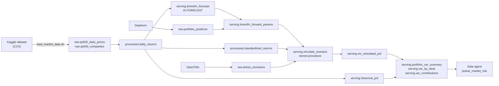
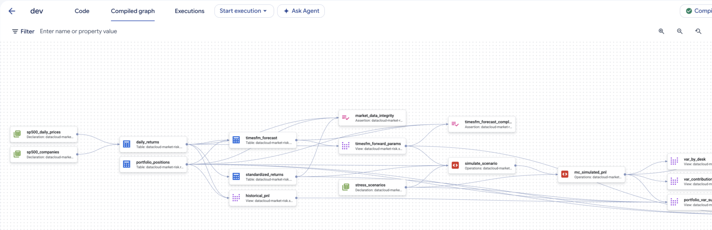
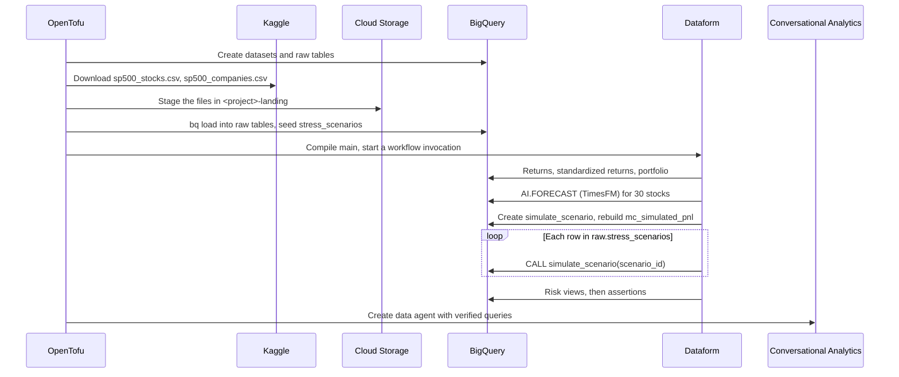
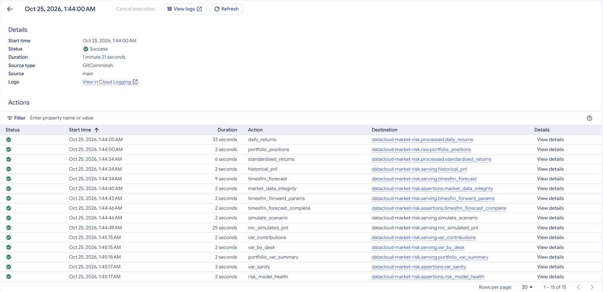

# Market Risk VaR on BigQuery Architecture

Datasets are named for the pipeline stage. The domain (`market_risk`) is a Dataform tag, not a dataset.

## Pipeline Overview

What gets built, and how it is connected:



The same graph as Dataform compiles it:



*Console on 2026-10-25.*

## Data Flow

In what order things happen on `tofu apply`, and which calls are made:



A pipeline run in Dataform, every action green:



*Console on 2026-10-25.*

## Key Components

| Stage | Object | Purpose |
| --- | --- | --- |
| `raw` | `sp500_daily_prices`, `sp500_companies` | Kaggle files as landed. OpenTofu owns the tables, so a reload needs no pipeline run. |
| `raw` | `stress_scenarios` | Scenarios to simulate. You add rows with `INSERT`. |
| `raw` | `portfolio_positions` | Pulsar Capital's 30 synthetic positions |
| `processed` | `daily_returns` | Log returns per stock up to the as-of date in `workflow_settings.yaml` |
| `processed` | `standardized_returns` | Each return divided by its trailing 63-day volatility, last 1,000 trading days |
| `serving` | `timesfm_forecast` | Raw `AI.FORECAST` output: 5 steps, 99% interval |
| `serving` | `timesfm_forward_params` | 1-day TimesFM volatility per stock, next to its trailing one-year volatility |
| `serving` | `simulate_scenario` | Stored procedure: runs the Monte Carlo for one scenario |
| `serving` | `mc_simulated_pnl` | One row per scenario, path and position |
| `serving` | `portfolio_var_summary`, `var_by_desk`, `var_contributions`, `historical_pnl` | The risk views the guide and the agent read |
| `assertions` | `market_data_integrity`, `timesfm_forecast_complete`, `var_sanity` | Hard-fail checks |
| `assertions` | `risk_model_health` | Warning view: inputs outside their usual range |

## The simulation

`serving.simulate_scenario` runs a filtered historical simulation:

1. Each path is assigned one of the last 1,000 trading days by a hash of its path number.
2. For every stock, the path takes that day's standardized return: the actual return divided by the stock's trailing 63-day volatility at the time. Because all 30 stocks come from the same day, they keep that day's co-movement and its fat tails.
3. A small amount of independent Gaussian noise (weight 0.25, rescaled to keep unit variance) is added per stock. Without it, 100,000 paths would yield only 1,000 distinct portfolio outcomes. It lowers cross-stock correlation by about 6%.
4. The result is multiplied by the stock's TimesFM 1-day volatility. Drift is zero.
5. A scenario's shock is added as `ln(1 + shock_pct)` to every stock in its sector, or to every stock when the sector is `NULL`.

The noise also comes from hashes, not `RAND()`. Every scenario replays the same draws on the same paths, so a stress result differs from the baseline by the shock alone.

### Core artifact: one row of `mc_simulated_pnl`

| Field | Type | Meaning |
| --- | --- | --- |
| `scenario_id` | STRING | Scenario from `raw.stress_scenarios` |
| `path_id` | INT64 | Path number, 1 to 100,000 |
| `historical_date` | DATE | The trading day this path replays |
| `symbol`, `sector`, `desk`, `book` | STRING | The position |
| `notional_usd` | FLOAT64 | Position size |
| `sim_log_return` | FLOAT64 | Simulated 1-day log return, including any shock |
| `sim_pnl_usd` | FLOAT64 | `notional_usd × (exp(sim_log_return) − 1)` |

```json
{
  "scenario_id": "baseline",
  "path_id": 42,
  "historical_date": "2025-08-12",
  "symbol": "JPM",
  "sector": "Financials",
  "desk": "Value Equities",
  "book": "US Financials",
  "notional_usd": 6000000.0,
  "sim_log_return": 0.01282,
  "sim_pnl_usd": 77444.54
}
```

## Observed behaviour

| Behaviour | Published docs | Observed | Verified on |
| --- | --- | --- | --- |
| `AI.FORECAST` timestamps on trading-day data | Frequency is inferred from the input | Steps land on calendar days: the step after Friday 2026-10-23 is dated Saturday 2026-10-24 | 2026-10-25 |
| `AI.FORECAST` repeatability | Not stated | One of three identical queries returned a slightly different JPM interval (about 0.2%). A full pipeline rerun can move portfolio VaR by about 0.6%. | 2026-10-25 |
| `AI.FORECAST` output | Median plus one prediction interval at `confidence_level` | Same. No sample paths or quantiles, so Expected Shortfall needs the simulation. | 2026-10-25 |

## Data quality

| Folder | Type | Semantics |
| --- | --- | --- |
| `definitions/assertions/` | `"assertion"` | Hard fail. Any returned row fails the run. |
| `definitions/monitoring/` | `"view"` in the `assertions` dataset | Warning only. Never blocks a run. |

## Navigation

[← Overview](README.md) | [Value at Risk](01-value-at-risk.md) | [Quick Reference](quick.md)
